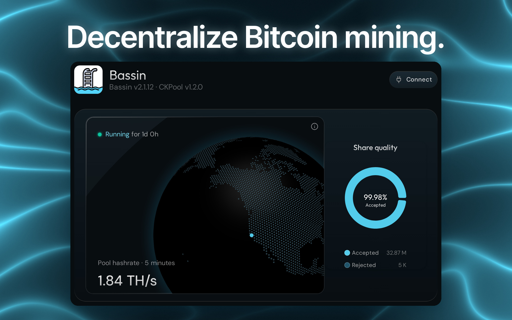
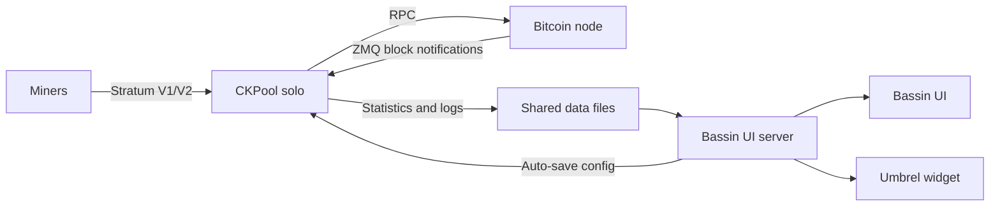

<p align="center">
  
</p>

# Bassin

Run a Bitcoin solo mining pool on your Umbrel. Your node supplies the block templates. If your miner finds a block, the default solo configuration pays the block reward to your Bitcoin address. Bassin charges 0% pool fees.

Bassin combines [CKPool](https://github.com/ckolivas/ckpool) with a dashboard based on the [Umbrel Bitcoin UI](https://github.com/getumbrel/umbrel-bitcoin/tree/master/apps/ui). Open Home to see your pool’s hashrate, or use Insights to check an individual worker.

**Current community release: package 2.1.17 (Bassin UI 2.1.17) with CKPool `v1.2.0-2` (Bitcoin Core v32+ IPC mining with RPC/ZMQ fallback, hardened Bearer-authenticated Config API with key allowlist & explicit Save/Restart, 2-container low-RAM architecture, and built-in Worker Best Diff Leaderboard widget).** Install it through the [Blockdyor community app store](https://github.com/blockdyor/blockdyor-umbrel-community-app-store). The official store still ships 2.1.4 as of 22 November 2026; [PR #6404](https://github.com/getumbrel/umbrel-apps/pull/6404) proposes 2.1.17.



California is the demo location shown in the gallery. Self-hosting keeps your pool under your control; it does not make mining anonymous. A winning block’s payout address is public.

[View the 0% pool fees panel](docs/gallery/02-fees.jpg) · [View the self-hosting and privacy panel](docs/gallery/03-privacy.jpg)

## What’s inside

These features describe the community dashboard. The official store’s 2.1.4 dashboard does not have the Connect dialog, Insights, or the Settings editor and log viewer. You can still connect a miner using the values below.

- **Home:** interactive globe, accepted/rejected share quality, and animated hashrate averages from one minute to seven days.
- **Insights:** workers, round best share, best share ever, share rate, uptime, a hashrate chart, live **Stratum V2 & Job Declaration** telemetry, and searchable worker details.
- **Stratum V2 (Noise-encrypted):** built-in Stratum V2 mining (`3457`) and optional Job Declaration (`3458`) alongside Stratum V1 (`3456`), with persistent private Noise keys stored in `data/sv2/` and live authority public-key discovery in **Connect → Stratum V2**.
- **Settings (hardened live editor):** dedicated **Mining**, **Stratum V2**, **Bitcoin Node**, **Advanced**, and **Logs** tabs backed by a Bearer-authenticated Config API (`BASSIN_CONFIG_TOKEN` / Umbrel deterministic app password) and strict key allowlist (blocking `donation`, `btcaddress`, `logdir`, `proxy`, and `redirecturl`). Explicit **Save** (writes without kicking miners/rentals) and **Save & Restart Pool** (gated reload with active-worker confirmation).
- **Logs:** searchable pool logs with pause, follow, and download controls (accessible without unlocking Settings).
- **Worker setup:** Stratum V1 and Noise-encrypted Stratum V2 connection details with QR codes. The default solo configuration pays the successful miner’s Bitcoin address the full block subsidy and transaction fees, with no pool commission.
- **Bitcoin Core IPC & Bitcoin Knots compatible:** mounts `${APP_BITCOIN_DATA_DIR}:/bitcoin:ro` on `ckpool` so Bitcoin Core v32+ users with Umbrel’s **IPC Mining Interface** enabled get native Cap’n Proto IPC (`/bitcoin/node.sock`) automatically, while keeping full JSON-RPC + ZMQ fallback for Bitcoin Knots (29.3 and earlier) and non-IPC Bitcoin Core nodes.
- **UTC throughout:** a UTC clock in Insights, UTC chart and worker timestamps, and the original UTC pool logs.
- **Version visibility:** the header shows the Bassin version and detects the installed CKPool version when metadata is available.
- **Mobile improvements:** responsive layouts, readable chart tooltips, reduced graphics load on touch devices, and a static globe fallback if graphics are interrupted.
- **Umbrel widgets & low RAM:** three built-in umbrelOS dashboard widgets (**Pool Overview**, **Worker Best Diff Leaderboard** ranking workers by all-time best share difficulty, and **Hashrate Averages**) served directly from the UI container — eliminating separate `www` and `widget-server` containers alongside `MALLOC_ARENA_MAX=2`, 256 KiB thread stacks, and lazy-loaded UI chunks.

**Settings requires your Bassin app password (shown in Umbrel) and saves only when you click Save or Save & Restart Pool.** See [Settings and notifications](docs/settings.md) for details.

## Install and connect

1. Run a fully synchronized Bitcoin node on Umbrel (Bitcoin Core or Bitcoin Knots).
2. For the current community release, open **App Store → Community App Stores** on your Umbrel and add the following store URL (not this documentation repository):

   ```text
   https://github.com/blockdyor/blockdyor-umbrel-community-app-store
   ```

3. Install Bassin from that store and open **Connect → Stratum** (V1), **Connect → Stratum V2**, or **Connect → Worker Setup**.
4. Configure your miner with the following values:

   | Miner setting | Stratum V1 | Stratum V2 (Noise-encrypted) |
   | --- | --- | --- |
   | Pool URL | `stratum+tcp://<your-Umbrel-address>:3456` | `stratum2+tcp://<your-Umbrel-address>:3457/<authority-pubkey>` |
   | Username / User Identity | `<your-bitcoin-address>.<worker-name>` | `<your-bitcoin-address>.<worker-name>` |
   | Password | `x` | *(unused)* |

Copy the pool’s Base58Check authority public key (or scan its QR code) directly from **Connect → Stratum V2**. Use a receiving address from your own Bitcoin wallet. The address before the dot selects the payout; the suffix identifies the miner. An address alone also works. Never enter a wallet seed or private key. Solo mining does not provide regular payouts for submitted shares.

The [official Umbrel App Store listing](https://apps.umbrel.com/app/bassin) is also available, on its own release schedule. Read the [installation guide](docs/getting-started.md) before switching channels: the apps have different IDs and data directories, and both use Stratum port `3456` (community 2.1.15 also binds `3457` and `3458` for Stratum V2).

## Documentation

- [Getting started, updates, and release channels](docs/getting-started.md)
- [Settings, Stratum V2, ZMQ, polling, and live auto-save](docs/settings.md)
- [FAQ: shares, history, UTC, versions, privacy, and troubleshooting](docs/FAQ.md)
- [What changed in the redesigned Bassin](docs/whats-new.md)
- [GitHub Wiki](https://github.com/blockdyor/bassin/wiki)

## Project repositories

| Repository | Purpose |
| --- | --- |
| [Bassin](https://github.com/blockdyor/bassin) | Project overview, documentation, support, and shared app assets |
| [Bassin UI](https://github.com/blockdyor/bassin-ui) | Dashboard source, builds, and UI development instructions |
| [CKPool Solo container](https://github.com/blockdyor/docker-ckpool-solo) | Blockdyor-maintained packaging of upstream CKPool |
| [Bassin widget](https://github.com/blockdyor/umbrel-bassin-widget) | Umbrel dashboard widget |
| [Blockdyor community package](https://github.com/blockdyor/blockdyor-umbrel-community-app-store/tree/master/blockdyor-bassin) | Current community deployment and release manifest |
| [Official Umbrel package](https://github.com/getumbrel/umbrel-apps/tree/master/bassin) | Official deployment, reviewed and released separately |

The `duckaxe-bassin/` directory and `umbrel-app-store.yml` in this repository are legacy packaging. Use the maintained store repositories above for installation; the legacy package does not represent the current community release. Existing icon and gallery paths remain available for store integrations.

## How it works



The pool continues mining when the browser is closed. The UI reads pool statistics and logs; its live chart samples are collected during your visit. See the [FAQ](docs/FAQ.md) for the difference between chart history and CKPool’s saved statistics.

## Credits and licensing

Bassin was created by [duckaxe](https://github.com/duckaxe) and is now maintained by [blockdyor](https://github.com/blockdyor). Thanks to [Umbrel](https://umbrel.com) for the Bitcoin app UI and app platform, and to [Con Kolivas and CKPool contributors](https://github.com/ckolivas/ckpool) for the mining backend.

This repository retains its [GPLv3 license](LICENSE). The UI includes upstream code with its own licensing terms; consult [Bassin UI’s third-party notices](https://github.com/blockdyor/bassin-ui/blob/main/THIRD_PARTY_NOTICES.md) before reusing or redistributing it.

For academic and research purposes only.

For bugs and feature requests, [open an issue](https://github.com/blockdyor/bassin/issues). For vulnerabilities, follow the [security policy](SECURITY.md) and keep credentials out of public reports.
