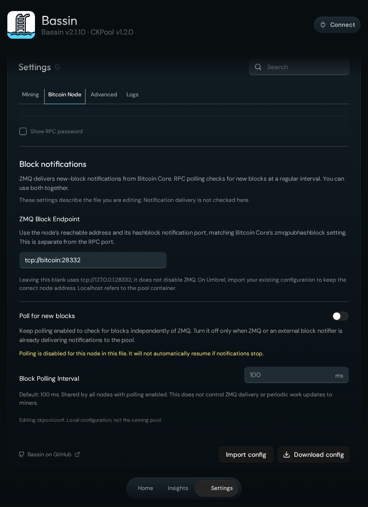

# Settings and Bitcoin node notifications

[Back to Bassin](../README.md)

These instructions describe community release 2.1.15. Open **Settings → Stratum V2** for encrypted Stratum V2 & Job Declaration options, **Settings → Bitcoin Node** for the Bitcoin RPC, ZMQ, polling, and optional Mining IPC controls, and **Mining** / **Advanced** for full CKPool tuning.

## Live auto-save & automatic CKPool reload

Starting in **2.1.15**, Settings connects directly to your running `data/config/ckpool.conf`:

- **Auto-loaded on open:** Settings reads your running `ckpool.conf` automatically. Stored Bitcoin RPC passwords stay on the server (masked in the browser) and are preserved automatically when you save other settings — you never have to re-enter your RPC password just to toggle Stratum V2 or adjust difficulty.
- **Auto-save on edit:** Whenever you toggle Stratum V2 or make any valid edit, Bassin validates the configuration and atomically saves `/config/ckpool.conf` (`0600`).
- **Automatic CKPool reload:** CKPool’s startup supervisor watches `/config/ckpool.conf` for changes, gracefully stops CKPool (`SIGTERM`), and restarts it with the new configuration within seconds. Newly enabled Stratum V2 authority keys appear automatically in **Connect → Stratum V2**.
- **Protected access:** Umbrel’s built-in proxy authentication protects the web UI and its `/api/config` endpoint; private Stratum V2 Noise keys in `data/sv2/` are never mounted in the UI container.
- **Backup & Restore:** **Import config** and **Download config** remain available for backing up or restoring configurations (imported valid configs auto-save immediately; downloaded backups omit server-stored RPC passwords unless you explicitly type one).

## Manual backup or offline editing

If you prefer to back up `data/config/ckpool.conf` manually (or are running the UI in a static preview without the live server):

1. Back up `data/config/ckpool.conf` privately outside `data/www`.
2. Use **Import config** to load a saved file, or **Download config** to export a backup.
3. Never put configuration or backup files in `data/www`.

## Bitcoin Core connection

**RPC Host and Port**, **RPC Username**, and **RPC Password** connect the pool to your Bitcoin node. Preserve the values generated by the Umbrel package unless you are deliberately changing the node.

The node-location helper uses HTTPS for public Bitcoin RPC endpoints. It allows plain HTTP only to a private or loopback address. This rule applies to the globe marker, not to miner Stratum connections or CKPool’s mining RPC client.

In Advanced, these fields appear under `btcd`. That is CKPool’s configuration name for its list of Bitcoin node connections; it does not mean you are using the separate btcd node implementation. For example, `btcd[0].pass` means the first node’s RPC password. Bitcoin Core’s daemon is `bitcoind`.

## ZMQ notifications and polling

The standard community package already configures a ZMQ hashblock endpoint. A working standard installation needs no notification changes merely because the UI was updated.

| Setting or mechanism | Meaning |
| --- | --- |
| **ZMQ Block Endpoint** | The address from which the pool receives Bitcoin Core’s new-block messages. Match the node’s `zmqpubhashblock` publisher using an address reachable from the pool container. This is separate from the RPC port. |
| **Poll for new blocks: on** | Enables periodic RPC checks for the first configured node; stores `notify: false`. ZMQ can still deliver notifications alongside polling. |
| **Poll for new blocks: off** | Disables those RPC checks; stores `notify: true`. Only use this when ZMQ or an external notifier is delivering block notifications. Polling will not automatically resume if those notifications stop. |
| **Block Polling Interval** | Milliseconds between checks for nodes with polling enabled. The default is `100` ms, and the value is shared by all such nodes. |
| Bitcoin Core’s **`blocknotify`** | A separate mechanism that runs a command when a block event occurs. It is not the polling switch and is not required for Bassin’s standard ZMQ setup. |

The polling switch only edits the first node; additional nodes keep their own notification settings. A filled-in endpoint is configuration, not a verified connection status. The UI does not currently observe or confirm notification delivery.

Use an endpoint such as `tcp://<node-address>:<hashblock-port>`, with a port from 1 to 65535. IPv6 literals need brackets. Use a reachable node address rather than a wildcard bind address such as `0.0.0.0`.

**Clearing the ZMQ field does not disable ZMQ.** With no explicit endpoint, CKPool uses `tcp://127.0.0.1:28332`. In the pool container, localhost means that container, not the separate Bitcoin node container. Importing the existing configuration preserves the correct Umbrel address.

## Stratum V2 and Noise keys

Open **Settings → Stratum V2** to configure Noise-encrypted Stratum V2:

| Setting | Key | Meaning |
| --- | --- | --- |
| **Enable Stratum V2 Mining** | `sv2url` | Bind address(es) for SV2 Mining clients (container default `0.0.0.0:3336`, published on host port `3457`). Works over standard JSON-RPC + ZMQ with both Bitcoin Core and Bitcoin Knots. |
| **Enable Job Declaration (JDS)** | `sv2jdurl` | Bind address(es) for SV2 Job Declaration clients (container default `0.0.0.0:3337`, published on host port `3458`). Validating declared block templates requires Bitcoin Core v32.x Mining IPC (`ipcmining`); without IPC, CKPool rejects declared jobs fail-closed while standard SV2 mining continues normally. |
| **Authority Key Path** | `sv2_authority_key` | Private secp256k1 Noise CA key path. Use `/sv2/sv2_authority.key` so the authority public key survives container restarts. |
| **Static Server Key Path** | `sv2_static_key` | Private server Noise static key path. Use `/sv2/sv2_static.key`. |

CKPool creates missing Noise keys automatically on first start. Never place private keys under `/www`. Without explicit paths, CKPool defaults to `/tmp`, which resets on restart and invalidates miner `stratum2+tcp://` URLs. Once running, Bassin’s helper reads the public Base58Check authority key from CKPool’s log and publishes only that public metadata to `/pool/sv2.json` for **Connect → Stratum V2**.

## Other settings

**Mining** exposes:
- **Minimum Difficulty** (`mindiff`, template `1`), **Starting Difficulty** (`startdiff`, template `42`), **High Difficulty Floor** (`highdiff`, optional), and **Maximum Difficulty** (`maxdiff`, `0` = unlimited).
- **Coinbase Signature** (`btcsig`, up to 38 UTF-8 bytes).
- **CKPool Developer Donation** (`donation`, `0` disabled or `0.1–99.9%`).
- **Version Rolling Mask** (`version_mask`, 1–8 hex digits, default `1fffe000`; set `0` to disable Stratum V2 version rolling).
- **Drop Idle Clients** (`dropidle`, seconds, `0` = never drop idle clients).

**Advanced** exposes:
- **Work Update Interval** (`update_interval`, default `30` s) and **Log Directory** (`logdir`, keep `/www` for Bassin UI).
- **Stratum V1 Listeners** (`serverurl`, comma-separated `host:port`; changing ports also requires matching container port mappings).
- **Extranonce1 / Extranonce2 Lengths** (`nonce1length` `2–8` default `4`, `nonce2length` `2–8` default `8`).
- **Connection Limits:** `maxclients`, `maxusers`, `maxsubclients` (`-1` = unlimited, default `65536`), `maxsendqueue` (bytes), and **Allow Client Reconnect** (`reconnect`, default enabled).
- **Custom Configuration:** full raw JSON editor that preserves additional nodes and custom CKPool options.

## CKPool v1.2.0-2, Bitcoin Core / Knots, and Mining IPC

The `blockdyor/docker-ckpool-solo:v1.2.0-2` image (upstream commit `be3e1e07` with pinned `secp256k1` `ebf59432`) compiles in **ZeroMQ**, **Stratum V2 (`--enable-sv2`)**, and optional **Cap’n Proto Mining IPC**.

- **Bitcoin Knots (including 29.3 and earlier) and standard Bitcoin Core nodes:** Leave **Mining IPC Socket (`ipcmining`)** blank in **Settings → Bitcoin Node**. CKPool uses standard JSON-RPC + ZMQ and never opens an IPC socket, so both Stratum V1 and Stratum V2 solo mining work out of the box.
- **Bitcoin Core v32.x Mining IPC (opt-in):** Set `ipcmining` to a mounted Unix socket from `bitcoind -ipcbind` if you want IPC template/block notifications or Stratum V2 Job Declaration (`sv2jdurl`).

The [pinned upstream configuration reference](https://bitbucket.org/ckolivas/ckpool/src/be3e1e0796fbea60b7792a9b62fc2614764e1fc0/README.md) and [container build](https://github.com/blockdyor/docker-ckpool-solo/blob/v1.2.0-2/Dockerfile) describe the underlying options and compiled capabilities.

*Bassin 2.1.10 screenshot with sample settings; no real RPC credentials are shown.*
